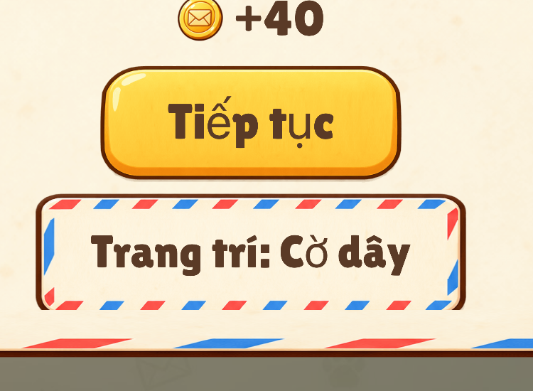

# Review UI/UX build 5 trên iOS Simulator (2026-10-15)

- **Bản kiểm:** commit `8947cb3` (build 5). `mobile/ios/App/App/public` đã sync sẵn. Build Debug cho simulator vào `mobile/build/sim` (thư mục đã nằm trong `.gitignore`).
- **Thiết bị:** app Capacitor thật (WKWebView), iOS 26.5.
  - **iPhone 17 Pro** (402×874 pt, Dynamic Island, inset trên 62 pt, dưới 34 pt).
  - **iPhone SE 3** (375×667 pt, inset trên 20 pt, dưới 0). Máy này không có sẵn nên tôi tạo mới tên "QA iPhone SE3". Có thể xoá bằng `xcrun simctl delete 4B3BAE2D-B821-4447-BBE8-E3DE590F0EF4`.
- **Thao tác:** chạm, kéo và vuốt thật qua công cụ điều khiển simulator. Đã chơi hết L1 trên cả hai máy (có kịch bản dạy), vào L2, mở Pause, Cài đặt (từ Pause và từ màn chính), Cách chơi, màn thắng, album. Đã thử cả 3 mức chữ.
- **Quy đổi:** stage 1080 px. Hệ số px → pt là **0,372** trên 17 Pro và **0,347** trên SE. Muốn đạt 44 pt trên SE thì cần **≥ 127 px stage**.
- **Ảnh:** `docs/qa/img/uiux-build5/`. Tiền tố `pro-` là iPhone 17 Pro, `se-` là iPhone SE. Ảnh màn thắng trên SE cắt từ video quay màn hình simulator.
- **Chưa làm được:**
  - Chưa chơi tới L11+, nên chưa thấy nút x2 (`.btn.small`).
  - Chưa mở bảng hết nước.
  - Chưa chụp màn thắng ở mức chữ Lớn: cả hai lần thắng đều đang để Rất lớn.
  - Hiệu năng trên simulator không đại diện cho máy thật.

---

## Kết luận nhanh

- **Vùng an toàn: ĐẠT** trên cả 2 máy, ở mọi màn đã mở. Đây là lỗi P0 của build 4.
  - Trên 17 Pro:
    - Đỉnh HUD cách đáy Dynamic Island khoảng 22 pt (HUD bắt đầu ở khoảng 72 pt, Island kết thúc ở khoảng 50 pt).
    - Nhãn "Hoàn tác" nằm trên vùng thanh home khoảng 11 pt.
  - Trên SE, HUD bắt đầu ở khoảng 30 pt, ngay dưới thanh trạng thái 20 pt.
  - Không thấy chỗ nào bị đè, cũng không thấy khoảng trống thừa. Điều này khớp với giả thuyết trong `r12-r13-tech-notes.md`: phải đo lại inset nhiều lần sau khi nạp.
- **Cỡ chữ:** 3 mức đổi ngay và giữ được. Popup ở mức Lớn và Rất lớn đọc tốt. Chữ phụ trên HUD và trên lá vẫn nhỏ (11–14 pt).
- **Màn thắng:** đúng thứ tự nút, "Tiếp tục" đứng đầu. Có 3 điểm kém Magic Sort:
  - ở mức Rất lớn, nút phụ bị cắt đáy;
  - khay trống ló sau bảng;
  - nút phụ to và nổi hơn nút chính.

---

## Danh sách vấn đề

### P0

Không có P0 mới.

### P1

**P1-1. Màn thắng ở mức Rất lớn: nút "Trang trí: Cờ dây" bị cắt mất viền đáy.** Thấy trên cả 2 máy.

Ảnh đầy đủ: `pro-09-win-final-ratlon.png`, `se-08-win-final-ratlon.png`.

- **Quan sát:**
  - Đường viền air-mail dưới đáy nút biến mất. Nút trông như bị lấp, không còn ra một cái nút.
  - Vuốt trong thân bảng không cuộn được.
- **Giả thuyết:** sau khi `fitPanel()` chạy, thân `.pin` bị tính là tràn, hoặc chiều cao bị co theo `flex:0 1 auto; min-height:0`. Phần viền dưới của `border-image` (40 px) bị cắt vì `.panel` có `padding-bottom: 0`.
- **Đề xuất:**
  1. Thêm `padding-bottom: 28px` cho `.panel .pin`, không chỉ cho `.pin.scroll`. Lý do: viền đáy nút dày 40 px, cộng bóng 4 px.
  2. Ở màn thắng, bỏ dòng giải thích "Dùng Tem Điểm để trang trí bưu điện của bạn" khi người chơi đã thấy nó ≥ 1 lần (cờ `seen`). Bảng sẽ ngắn lại khoảng 120 px ở mức Rất lớn, nên không còn chạm `max-height`.
  3. Gọi lại `fitPanel(p)` sau bước đóng cộp Tem Điểm cuối cùng (khoảng 2,0 giây) và trong `finishWin()`.

**P1-2. Màn thắng: nút phụ to và nổi hơn nút chính.** Thấy ở `pro-09-win-final-ratlon.png` và `se-08-win-final-ratlon.png`.

- Trên 17 Pro, "Tiếp tục" rộng khoảng 141 pt (`min-width:380px`). Nút "Trang trí: …" rộng khoảng 200 pt, có viền sọc đỏ-xanh rực.
  - Mắt người lớn tuổi bị kéo xuống nút dưới.
  - Magic Sort chỉ có một nút chính rất to ở giữa.
- **Đề xuất:**
  - `.panel.win .btn:first-of-type`: `min-width: 600px` (khoảng 223 pt trên Pro, 208 pt trên SE), `font-size: calc(56px * var(--fs))`. Thêm nhịp "thở" scale 1→1,04 mỗi 1,6 giây sau khi bỏ `.wait`, và tắt nhịp này khi bật Giảm chuyển động.
  - Nút trang trí: dùng kiểu phụ giấy kem viền nâu như `.btn.small` nhưng cao ≥ 127 px. Bỏ viền air-mail sọc, `max-width: 520px`.

**P1-3. Màn thắng: ba khay trống ló lên trên ruy băng.** Thấy ở `crop-win-trays-behind-panel.png` và `se-10-win-wait-state.png`.

- Khay (`slotEls`) vẫn hiện, chỉ bị lớp mờ phủ. Phần nắp khay thò ra giữa HUD và ruy băng "Tuyệt vời!", nên trông như lỗi xếp lớp.
- **Đề xuất:** khi phong bì bay xong (khoảng 0,9 giây), đặt `opacity:0` cho `slotEls` và `extraEl` trong 200 ms. `finish()` cũng phải làm vậy. Cách khác: cho `.panel.win` `--ptop: 360px` để ruy băng che hết hàng khay, nhưng cách này làm bảng dài hơn, nên ưu tiên cách đầu.

**P1-4. Vùng chạm nhỏ hơn 44 pt.** Đo theo CSS, đã đối chiếu ảnh.

| Phần tử | CSS hiện tại | 17 Pro | SE | Đề xuất |
|---|---|---|---|---|
| Mũi tên/khoá chương `.ch-arrow` (màn chính, cạnh "Chương 1") | 104×104 px | 38,7 pt | 36 pt | `flex:0 0 128px; height:128px`, hoặc thêm `::after{inset:-14px}` như `.btn-round` |
| Nút chia đoạn trong Cài đặt `.seg b` | `min-height:112px` | 41,7 pt | 38,9 pt | `min-height:128px` |
| Bật/Tắt cùng dòng `.set-row.inline .seg` | rộng 330 px, chia 2 → khoảng 160 px mỗi nút | 59 pt | 55 pt | Đạt chiều ngang, chỉ cần sửa chiều cao như trên |

Ảnh: `pro-11-home-ratlon.png` (nút khoá cạnh "Chương 1 Phố Chính"), `se-04-settings-lon.png`.

Các nút khác đạt:

| Phần tử | Kích thước |
|---|---|
| Pause | 108 px + vùng mở rộng 14 px, khoảng 50 pt |
| Undo | 140 px, khoảng 52/49 pt |
| Booster | 164 px, khoảng 61/57 pt |
| `.btn` chính | cao khoảng 131 px, khoảng 49/45 pt |
| Lá bài | 165×214 px, khoảng 61×80 pt trên Pro |
| Ô level | 182 px, khoảng 68/63 pt |

**P1-5. Chữ trên lá vương miện và chữ phụ trên HUD quá nhỏ cho người lớn tuổi.** Thấy ở `crop-crown-card-counter.png` và `pro-10-game-l2-ratlon.png`.

| Chữ | CSS | 17 Pro | SE | Đề xuất |
|---|---|---|---|---|
| Bộ đếm "0/3" trên lá vương miện `.card .cnt` | 30 px | 11 pt | 10,4 pt | Đặt trên viên nền kem riêng, 38 px, ở góc trái dưới. Hiện số này đè lên mép icon và sát chân vương miện. Hoặc bỏ hẳn, vì khay đã có plate "0/3" 40 px |
| Tên chủ đề trên lá `.card .tag` | 30 px | 11 pt | 10,4 pt | Ghi chú R13 đã chốt sàn 34 px cho nhãn vương miện. Ảnh L1/L2 cho thấy "Pizza"/"Chim" đang khoảng 34 px (12–13 pt), vẫn nhỏ. Nên lên 38 px, 2 dòng |
| "NƯỚC" `.hud-moves .lbl`, số xu `.hud-coins` | 34 px | 12,6 pt | 11,8 pt | 40 px |
| "0/3" tiến độ thư `.combo .txt` | 38 px | 14 pt | 13,2 pt | 44 px |

Không nhân `--fs` cho các chữ này là đúng, vì kích thước cố định. Nhưng **mức nền** cần nâng: chuẩn chữ phụ cho người lớn tuổi khoảng ≥ 15 pt (`older-players-pass.md`).

### P2

**P2-1. Chữ dạy và toast vẫn hiện sau panel Pause, Cài đặt, Cách chơi, bị cắt nửa.** Thấy ở `se-06-pause-ratlon.png`: dòng "Drag the crown stamp to an empty slot." thò ra dưới đáy bảng.

- Đề xuất: khi `panel()` mở thì thêm class `.tut.hold { opacity:0 }`, đóng panel thì bỏ class.

**P2-2. Toast kịch bản L1 che mép trên lá đang lật ở hàng rút bài.** Toast "Ô trống cần tem vương miện." ở khoảng y 1240–1310 (thang 2000) đè lên đỉnh lá vương miện ở hàng rút bài trên 17 Pro. Ảnh chụp lúc chơi chưa lưu riêng, cùng bố cục với `pro-02-game-l1.png`.

- Đề xuất: khi có lá ở hàng rút bài, cho `.toast.high` đẩy toast lên trên `ROW_A − 24px`, hoặc đặt toast dưới hàng rút bài như `tut`.

**P2-3. Nhãn Cài đặt xuống dòng xấu.**

- "Giảm chuyển động" thành 2 dòng ở mức Lớn trên 17 Pro (`pro-04-settings-lon.png`). Lý do: cụm Bật/Tắt chiếm 330 px.
- "Extra / large" thành 2 dòng trên SE (`se-05-settings-ratlon.png`).
- Đề xuất:
  - đổi copy thành "Bớt hiệu ứng" / "Less motion" (ngắn hơn 6–8 ký tự);
  - thu `.set-row.inline .seg` còn `width: 300px`;
  - `.seg b` dùng `font-size: calc(40px * min(var(--fs), 1.15))` giống nhãn booster.

**P2-4. Cách chơi: icon nhỏ, chữ mồ côi.** Thấy ở `pro-07-rules-ratlon.png` và `se-07-rules-ratlon.png`.

- Icon khoảng 28 pt. Có dòng chỉ còn 1 từ: "ô.", "nước.", "nhau.".
- Đề xuất:
  - icon 110 px (khoảng 40 pt);
  - rút copy: "Tem vương miện mở ô mới." / "Gửi hết thư trước khi hết nước.";
  - thêm `text-wrap: pretty` (WebKit 17.4+ có hỗ trợ).

**P2-5. Màn chính vẫn còn vẻ "prototype".** Thấy ở `pro-01-home.png`, `se-01-home.png`, `pro-11-home-ratlon.png`.

- Nút "Cài đặt" bằng chữ, nằm đè lên đầu dây cờ (Pro) và đè khung tranh mèo (SE). Đề xuất: icon bánh răng tròn 108 px (`ic_settings.png` đã có, chưa track trong git) đặt `right:40px; top: calc(32px + var(--hud))`, cùng hàng và cùng cỡ với nút Pause trong màn chơi.
- Dây cờ "bóng" xám (món decor kế tiếp) ở mép trên trông như ảnh lỗi với người mới. Đề xuất: chỉ hiện bóng khi người chơi đủ Tem Điểm, hoặc thêm nhãn "Sắp mở".
- Vẫn có 3 kiểu nút: kẹo xanh "Album", kẹo vàng, khung air-mail. Benchmark G3 yêu cầu 1 kiểu chính và 1 kiểu phụ.
- "Chương 1 Phố Chính" 38 px (khoảng 14 pt), chữ kem viền nâu trên nền sáng, tương phản thấp. Đề xuất 44 px, thêm viên nền kem.

**P2-6. Pause: 4 nút phụ trông giống hệt nhau.** Thấy ở `pro-03-pause.png` và `se-03-pause.png`.

- "Chơi lại" và "Trang chủ" (có hộp xác nhận) cùng kiểu với "Cách chơi" và "Cài đặt".
- Đề xuất: tách thành 2 nhóm, cách nhau 40 px. "Cách chơi" và "Cài đặt" dùng icon + chữ. "Chơi lại" và "Trang chủ" để hàng dưới, chữ nâu nhạt hơn.

**P2-7. Dải gỗ booster ở L1–L3 trống.** Chỉ có Undo và 1 booster khoá "Lv 2" / "Lv 4" (`pro-10-game-l2-ratlon.png`).

- Booster khoá trông như nút bấm được, cùng kích thước và viền. Đề xuất: booster khoá thu về 120 px, `opacity:.55`, viền nét đứt.

**P2-8. Nhịp thắng hơi dài trước khi thấy bảng.** Đo từ video SE, chi tiết ở mục "Màn thắng" bên dưới.

- Từ lúc chạm lá cuối tới khi bảng hiện mất khoảng 3,7 giây, tới khi nút bấm được mất khoảng 4,9 giây. Phần lớn là hoạt cảnh gửi thư cuối, khoảng 1,6 giây trước khi timeline thắng bắt đầu.
- Đề xuất: ở lá thắng, rút hoạt cảnh gửi thư cuối còn ≤ 0,8 giây, hoặc cho timeline thắng bắt đầu song song với lúc phong bì cuối bay.

---

## Đánh giá theo mục yêu cầu

### 1. Vùng an toàn: Đạt

| Màn | 17 Pro | SE |
|---|---|---|
| Màn chính | `pro-01-home.png`, `pro-11-home-ratlon.png`: dây cờ và nút Cài đặt nằm dưới Island | `se-01-home.png` |
| Màn chơi | `pro-02-game-l1.png`, `pro-10-game-l2-ratlon.png` | `se-02-game-l1.png` |
| Pause | `pro-03-pause.png`, `pro-06-pause-ratlon.png` | `se-03-pause.png`, `se-06-pause-ratlon.png` |
| Cài đặt | `pro-04-settings-lon.png`, `pro-05-settings-ratlon.png`, `pro-13-settings-thuong.png` | `se-04-settings-lon.png`, `se-05-settings-ratlon.png` |
| Màn thắng | `pro-08-win-early.png`, `pro-09-win-final-ratlon.png` | `se-08-win-final-ratlon.png`, `se-09-win-confetti.png`, `se-10-win-wait-state.png` |
| Album | `pro-12-album-ratlon.png`: khung cách Island và thanh home vừa đủ, nút "Đóng" nằm trên thanh home | (chưa mở) |

- Khoảng trống không quá nhiều. Trên 17 Pro, phần dư dọc dồn vào giữa cột bài và hàng rút bài, hợp lý vì cột có thể dài ở level sau.
- **Lưu ý:** đây là simulator. Vẫn nên xác nhận nhanh trên TestFlight build 5 ở 1 máy có Island, vì inset trong WKWebView thật có thể đến muộn hơn.

### 2. Cỡ chữ 3 mức

- Đổi ngay, bảng dựng lại tại chỗ (`pro-13`, `pro-04`, `pro-05`).
- **Mức Lớn mặc định** đã dễ đọc cho người lớn tuổi. Chữ popup khoảng 20 pt trên Pro.
- Rất lớn không tràn ngang ở Pause, Cài đặt, Cách chơi trên SE. Nút Play "Chơi tiếp Level 2" vừa khít.
- Lỗi ở mức này: P1-1 (nút màn thắng bị cắt), P2-3, P2-4.
- Chữ cố định (HUD, lá) không đổi theo mức chữ, xem P1-5.

### 3. Vùng chạm

- Đa số đạt. Hai chỗ thiếu: P1-4 (mũi tên chương, nút chia đoạn Cài đặt).
- Lá và cột cách nhau đủ, kéo thả bằng ngón ảo không bị nhầm cột.
- Một điểm cần biết khi test: ở bước kịch bản, kéo sai đích bị từ chối im lặng (lá quay về) và hiện toast "Làm theo bàn tay". Hành vi đúng thiết kế.

### 4. Màn thắng

Đo từ video SE (5 khung/giây, `t` = 0 là lúc bắt đầu quay):

| t | Diễn biến |
|---|---|
| 6,3 s | Chạm lá mèo cuối |
| 7,2–8,4 s | Thư "Mèo · gửi Pip" bay đi |
| 9,0–9,2 s | Ba khay thành phong bì, bay vào thanh tiến độ |
| 9,6 s | Confetti |
| 10,0 s | Bảng trượt lên, nút đang `.wait` mờ |
| 10,4–10,8 s | Tem Điểm đóng cộp |
| 11,2 s | Nút bấm được |
| 11,6–12,4 s | Xu đếm 500 → 528 → 540 trên ô xu nổi trên lớp mờ |

- **Tốt:**
  - Thứ tự đúng spec 4.3.
  - Ô xu nổi trên lớp mờ và đếm dần: chi tiết "premium" đã có.
  - Chạm tua (theo test Chrome) không bấm nhầm nút.
  - Nút "Tiếp tục" màu vàng rõ.
- **Kém Magic Sort:**
  - Phong bì bay vào thanh tiến độ nhỏ ở HUD nên gần như không thấy. Túi thư `[ART]` sẽ giải quyết.
  - Confetti chỉ là một chùm nhỏ dưới hàng khay (`pro-08-win-early.png`, `se-09-win-confetti.png`), chưa rơi khắp màn. Spec muốn 40–60 mảnh rơi chậm 2,5 giây, nên cần phát từ mép trên màn hình.
  - Bảng nhiều chữ: 4 khối chữ cùng độ đậm ("+3 Tem Điểm", câu giải thích, lời Pip, +40 xu). Magic Sort chỉ có tiêu đề, phần thưởng và 1 nút. Đề xuất:
    - bỏ câu giải thích sau lần đầu (xem P1-1);
    - lời Pip in nghiêng 42 px màu nhạt hơn;
    - "+40" lên 64 px, đặt cạnh "+3 Tem Điểm" trên một hàng phần thưởng.
  - Nút `.wait` mờ 0,6 trong khoảng 1,2 giây dễ bị đọc là "nút hỏng". Đề xuất: ẩn hẳn (`visibility:hidden`) rồi bật lên bằng scale 0,9→1 trong 160 ms khi sẵn sàng.
  - Thêm P1-2 và P1-3.

### 5. Cảm nhận tổng thể so với Grand Games

- **Đạt:**
  - Hệ màu kem, nâu gỗ, air-mail đồng bộ. Art lá đẹp và nhất quán.
  - Lá là vùng tương phản cao nhất (G1).
  - Ruy băng và panel giấy có chất riêng.
  - Bàn chơi sạch, không quảng cáo hay biểu ngữ thừa.
- **Còn "prototype":**
  - Nút Cài đặt bằng chữ và dây cờ "bóng" xám (P2-5).
  - 3 kiểu nút: nút xanh kẹo lệch tông giấy gỗ.
  - Khay trống ló ở màn thắng (P1-3).
  - Booster khoá giống nút thật (P2-7).
  - Chữ dạy thò sau panel (P2-1).
  - Bảng thắng nặng chữ.
- **Phân cấp:** HUD đã lùi về sau, tốt. Nhưng màn thắng và Pause chưa có một điểm nhấn duy nhất.

### 6. Hiệu năng cảm nhận

- Trên simulator (Mac), không thấy giật khi kéo, lật, gửi thư hay ở màn thắng. Video 30 fps không thấy khung đứng hình.
- Simulator chạy bằng GPU Mac nên **không dùng để kết luận** cho máy yếu. Cần đo trên iPhone thật, ưu tiên iPhone SE/11, ở khoảnh khắc confetti cộng bảng trượt cộng xu bay (khoảng 1,0–2,6 giây sau khi thắng).

---

## Đạt

- Vùng an toàn trên máy có Dynamic Island và trên SE: HUD, booster, album, Pause, Cài đặt, màn thắng đều không bị đè.
- Bảng Cài đặt đủ 6 mục, đổi tức thì, mở được từ Pause (đóng thì quay lại Pause) và từ màn chính.
- Pause gọn còn 5 nút.
- 3 mức chữ không tràn ngang ở Pause, Cài đặt, Cách chơi, Album, kể cả trên SE ở mức Rất lớn.
- Màn thắng: "Tiếp tục" đứng đầu, ô xu nổi trên lớp mờ, xu đếm dần, nhịp ≤ 2,6 giây từ lúc bắt đầu timeline thắng.
- Đa số vùng chạm ≥ 44 pt. Lá bài khoảng 61×80 pt.
- Copy tiếng Việt và tiếng Anh không bị cắt "...".
