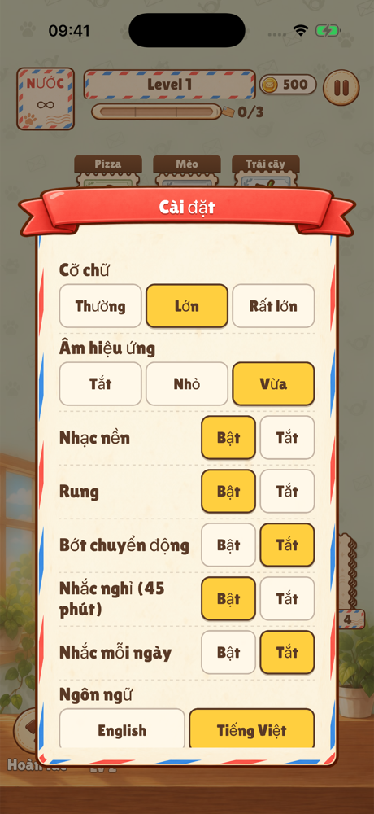

# Review UI/UX build 6 trên iOS Simulator (2026-10-15)

- **Bản kiểm:** commit `3f0e71b` (build 6). Web bundle đã có sẵn trong `mobile/ios/App/App/public`, tôi không chạy sync. Build Debug cho simulator vào `mobile/build/sim`.
- **Thiết bị:** app Capacitor thật (WKWebView), iOS 26.5, cài sạch (gỡ app cũ trước).
  - **iPhone 17 Pro:** 402×874 pt, Dynamic Island.
  - **"QA iPhone SE3":** 375×667 pt, inset trên 20 pt, dưới 0.
- **Quy đổi:** stage 1080 px. Hệ số px → pt là **0,372** trên Pro và **0,347** trên SE. Muốn 44 pt trên SE thì cần ≥ 127 px.
- **Đã thao tác thật** (chạm, kéo, vuốt):
  - **Pro:**
    - Chơi hết L1 (kịch bản dạy) và thắng ở mức chữ Rất lớn.
    - Vào L2 (bảng Cách chơi, ô phụ).
    - Mở Pause, Cài đặt (cả 3 mức chữ), "Ván đang dở" sau khi tắt và mở lại app.
  - **SE:**
    - Chơi hết L1 và thắng ở mức Lớn, tiếng Anh.
    - Mở màn chính, Pause, Cài đặt (Lớn, Rất lớn).
- **Dữ liệu giả để xem màn chính đủ 5 điểm chạm:**
  - Trên Pro, tôi sửa thẳng save trong localStorage của app (sqlite trong container simulator): `unlocked 13`, xu 1240, `firstOpenDay` lùi 3 ngày. Bản gốc lưu ở scratchpad.
  - Sau đó đã mở: Thư buổi sáng, Thư hôm nay, Tuyến đưa thư, Trang trí (đặt Quạt trần), L13 với đủ 4 booster.
- **Chưa kiểm:**
  - Phần cần đổi ngày (Sổ dấu ngày qua nhiều ngày, Thẻ tuần đủ 5/5, Tem theo mùa, Việc vặt).
  - Nhắc nghỉ 45 phút.
  - Hộp xin quyền thông báo.
  - Chương 3–13.
  - **Không kiểm trên web localhost:8766.** Toàn bộ báo cáo này là kiểm trong app trên simulator.
- **Ảnh:** `docs/qa/img/uiux-build6/`. Tiền tố `pro-` là iPhone 17 Pro, `se-` là iPhone SE, `crop-` là ảnh cắt cận.

---

## Kết luận nhanh

- **Vùng an toàn: ĐẠT** trên cả 2 máy, ở mọi màn đã mở.
  - Màn chính mới: ô xu và bánh răng nằm dưới Dynamic Island. Album và Trang trí cách vùng thanh home khoảng 8 pt.
  - Màn chơi, Pause, Cài đặt, màn thắng, các bảng meta đều không bị đè.
- **5 lỗi P1 của build 5: 4 đã hết, 1 hết một phần.** Xem bảng ở mục tiếp theo.
- **Lỗi mới quan trọng nhất (P1):** nút "Đóng" của Cài đặt nằm dưới mép bảng ở **cả 3 mức chữ**, trên cả 2 máy.
  - Phải cuộn mới thấy, mà không có dấu hiệu nào báo là cuộn được.
  - Trên simulator, cuộn chỉ ăn khoảng một nửa số lần vuốt.
  - Chạm ra ngoài bảng không đóng được.
  - Người lớn tuổi rất dễ bị "kẹt" ở bảng này.

---

## Xác nhận 5 lỗi P1 của build 5

| # | Lỗi build 5 | Build 6 | Bằng chứng |
|---|---|---|---|
| P1-1 | Nút "Trang trí" ở màn thắng bị cắt đáy ở mức Rất lớn | **Đã hết.** Nút đủ viền. `.pin` có `padding-bottom: 28px` | `pro-09-win-final-ratlon.png` (Rất lớn), `se-08-win-final-lon.png` (Lớn) |
| P1-2 | Nút phụ to hơn nút chính | **Đã hết.** "Tiếp tục" rộng khoảng 223 pt, chữ 56 px, có nhịp thở. "Trang trí" thành nút phụ giấy kem, nhỏ hơn rõ | như trên |
| P1-3 | Khay trống ló sau bảng thắng | **Đã hết.** Khay thành phong bì bay vào túi thư, túi thay chỗ hàng khay | `pro-09-win-timeline-a.png`, `pro-09-win-t5.0.png` |
| P1-4 | Mũi tên chương và nút chia đoạn Cài đặt < 44 pt | **Đã hết.** Cả hai 128 px (47,6 pt / 44,4 pt) | `pro-14-home-l13.png`, `pro-04-settings-lon.png` |
| P1-5 | Chữ cố định quá nhỏ (đếm vương miện, HUD) | **Hết một phần.** Đã sửa: "NƯỚC" và số xu 40 px (14,9 pt), "0/3" thư 44 px, viên đếm vương miện 38 px (14 pt). Còn lại: tên chủ đề trên lá vẫn 34 px (12,6 / 11,8 pt). Viên đếm bị icon vẽ đè (xem N6). Màn chính mới thêm chữ nhỏ hơn nữa (xem N2) | `crop-hud-ratlon.png`, `crop-crown-pill-waste.png` |

Các P2 của build 5:

| # | Trạng thái |
|---|---|
| P2-1 chữ dạy sau bảng | **Hết** (`.tut.hold`) |
| P2-2 toast che lá | **Còn**, dạng mới N4 |
| P2-3 nhãn Cài đặt | **Hết một phần.** "Bớt chuyển động" 1 dòng ở mức Lớn, nhưng "Nhắc nghỉ (45 phút)" 2 dòng |
| P2-4 Cách chơi mồ côi chữ | **Còn**: "mở một / ô.", "vào / ô.", "hết / nước.", "lên / nhau." (`pro-10-after-continue.png`) |
| P2-5 màn chính | **Phần lớn hết**: có icon bánh răng, nút gọn còn 2 kiểu. Dây cờ "bóng" xám vẫn còn ở màn đầu (`pro-01-first-launch.png`) |
| P2-6 Pause | **Còn**: 4 nút phụ giống hệt nhau |
| P2-7 booster khoá | **Đỡ hơn**: tròn, có ổ khoá và "Lv N" |
| P2-8 nhịp thắng dài | **Còn** (xem N5) |

---

## Vấn đề mới

### P0

Không có.

### P1

**N1. Cài đặt: nút "Đóng" và mục Ngôn ngữ bị khuất dưới mép bảng ở mọi mức chữ. Cuộn không đáng tin, không có gợi ý cuộn.**

Ảnh: `pro-04-settings-lon.png` (Lớn), `pro-06-settings-thuong.png` (Thường), `pro-07-settings-ratlon.png` (Rất lớn), `se-02-settings-lon-home.png`.

- **Nguyên nhân:** bảng thêm 2 dòng mới, "Nhắc nghỉ (45 phút)" và "Nhắc mỗi ngày". Thân bảng (`.pin.scroll`) giờ dài hơn `max-height`, kể cả ở mức Thường trên 17 Pro.
- **Quan sát khi cuộn:**
  - Trên Pro, vuốt bắt đầu từ khoảng y ≥ 620 pt nhiều lần **không cuộn**. Vuốt từ khoảng 560 pt thì cuộn được. Ảnh: `pro-05-settings-lon-khong-cuon-duoc.png`, `pro-20-settings-l13-scrolled.png`.
  - Trên SE, vuốt xuống được nhưng vuốt ngược lên có lần không ăn.
  - Hiện chưa rõ nguyên nhân (giả thuyết: `touch-action` hoặc trình bắt chạm của bảng). **Cần thử trên máy thật.**
- Không có nút X trên ruy băng. Chạm ra lớp mờ cũng không đóng.
- **Đề xuất, theo thứ tự ưu tiên:**
  1. Đưa nút "Đóng" ra khỏi `.pin`: chân bảng cố định, luôn thấy, cao ≥ 128 px.
  2. Thêm nút X tròn 128 px ở góc phải ruy băng `.head`. Cho chạm lớp mờ đóng Cài đặt (bảng này không có thao tác nguy hiểm).
  3. Khi `.pin.scroll` bật, thêm dải mờ 64 px ở đáy (gradient kem → trong suốt) để báo còn nội dung.
  4. Rút gọn bảng để vừa ở mức Lớn trên SE:
     - gộp "Nhắc nghỉ" và "Nhắc mỗi ngày" vào một dòng "Nhắc nhở ›" mở bảng con;
     - `.set-row` padding 10/14 → 6/8 px;
     - Ngôn ngữ cùng dòng với nhãn (2 nút, 330 px).
  5. Kiểm lại `touch-action: pan-y` trên `.pin.scroll` và các con `.seg b` trên máy thật.

**N2. Chữ trên các ô mới ở màn chính quá nhỏ cho người lớn tuổi.** Thấy ở `crop-home-tiles-ratlon.png` và `pro-14-home-l13.png`.

| Chữ | CSS | 17 Pro | SE | Đề xuất |
|---|---|---|---|---|
| Số tiến độ event "0/20" `.event-tile .sub` | 26 px (trần ×1,1) | 9,7 pt | 9 pt | 38 px, đặt trên vạch tiến độ |
| Tên event "Tuyến đưa thư" `.event-tile .lbl` | 30 px | 11,2 pt | 10,4 pt | 36 px. Tên dài thì cho 2 dòng (`white-space: normal`) thay vì `nowrap` sát mép |
| "Thư hôm nay" `.daily-btn .lbl` | 33 px | 12,3 pt | 11,5 pt | 38 px |
| "Album" / "Trang trí" `.home-tile .lbl` | 34 px | 12,6 pt | 11,8 pt | 38 px |
| Huy hiệu Tem Điểm trên Trang trí `.pts` | 32 px | 11,9 pt | 11,1 pt | 38 px |

- Trần ×1,1 làm mức Rất lớn gần như không giúp gì cho các ô này.
- Ô 206×180 px còn chỗ, nên nâng mức nền chữ thay vì nhân hệ số.

### P2

**N3. Viên đếm "0/4" trên lá vương miện bị icon nét vẽ đè lên.** Thấy ở `crop-crown-pill-waste.png`: nét bánh pizza cắt qua số "4".

- Nguyên nhân: trong DOM, `.art` đứng sau `.cnt` nên được vẽ trên cùng.
- Đề xuất: `.card .cnt { z-index: 2 }`.

**N4. Hai hộp chữ dạy hiện cùng lúc ở L1.** Thấy ở `se-07-two-tips-stacked.png`.

- Toast "First stack it where the hand shows." nằm giữa màn, che vùng cột. Tut "Stack same-kind stamps on a column." nằm ở đáy.
- Người lớn tuổi phải đọc 2 câu khác nhau cùng lúc.
- Đề xuất: khi toast từ chối hiện ra thì ẩn tut (`.hold`) trong thời gian toast hiện, hoặc thay nội dung tut bằng câu từ chối.

**N5. Nhịp thắng vẫn dài.** Đo từ video:

| Máy | Từ lúc chạm lá cuối tới khi bảng hiện | Tới khi nút bấm được |
|---|---|---|
| Pro | khoảng 3,6 giây | khoảng 4,8 giây |
| SE | khoảng 2,9 giây | khoảng 4,7 giây |

Ảnh: `pro-09-win-timeline-a.png`, `se-09-win-timeline.png`.

- Giống build 5. Phần trước khi bảng hiện gồm: lá vào ô, bong bóng "Mèo · gửi Pip", rồi khay thành phong bì vào túi.
- Đề xuất (như build 5): ở lá thắng, rút hoạt cảnh gửi thư cuối còn ≤ 0,8 giây, hoặc cho timeline thắng chạy song song.

**N6. Trên SE, túi thư ở màn thắng đè lên ô tiêu đề "Level 1" của HUD.** Thấy ở `se-08-win-final-lon.png`.

- HUD đã bị lớp mờ phủ nên không phải lỗi chức năng, nhưng trông chồng chéo.
- Đề xuất: đặt túi theo `--ptop − 210px`, hoặc thu túi còn 0,8 khi chiều cao stage < 2000 px (máy tỉ lệ 16:9).

**N7. Bảng meta dày chữ.** Thấy ở `pro-15-daily-panel-ratlon.png` và `pro-16-event-route-ratlon.png`.

- **Thư hôm nay:**
  - Một màn có dấu ngày, 2 câu, Thẻ tuần, chú thích, Sổ dấu ngày và 3 nút.
  - Nhãn thứ "T2…CN" và số trạm khoảng 26–28 px (khoảng 10 pt).
  - Đề xuất: Thẻ tuần 7 ô to hơn (88 px), nhãn thứ 34 px; bỏ câu "Mỗi tuần 5 ngày là đủ…" sau lần đầu; "Đóng" thành chữ liên kết hoặc nút X.
- **Tuyến đưa thư:**
  - Số trạm trong vòng nét đứt khoảng 10 pt.
  - Đề xuất: chỉ hiện trạm hiện tại ±3, mỗi trạm 96 px.

**N8. Copy tiếng Anh trong Cài đặt trên SE:** "Rest reminder (45 min)" thành 2 dòng ở mức Lớn. Có thể gọn thành "Break reminder".

---

## Đánh giá theo mục

### 1. Vùng an toàn: Đạt

| Màn | 17 Pro | SE |
|---|---|---|
| Màn chính (mới) | `pro-01-first-launch.png`, `pro-14-home-l13.png` | `se-01-first-launch.png`, `se-04-game-l1.png` |
| Màn chơi | `pro-02-game-l1.png`, `pro-11-game-l2-ratlon.png`, `pro-19-game-l13-ratlon.png` | `se-04-game-l1.png` |
| Pause | `pro-03-pause-lon.png`, `pro-12-pause-ratlon.png` | `se-05-pause-lon.png` |
| Cài đặt | `pro-04/06/07` | `se-02`, `se-03`, `se-06` |
| Màn thắng | `pro-09-*` | `se-08-win-final-lon.png` |
| Bảng meta | `pro-13`, `pro-15`, `pro-16`, `pro-17` | (chưa mở) |

- Dải booster 5 nút ở L13: nhãn "Tem Vàng" kết thúc ở khoảng 830 pt, vùng thanh home bắt đầu ở 840 pt. Sát nhưng đạt (`crop-booster-row-ratlon.png`).
- Album chưa mở được ở build này (đã ưu tiên các màn mới).

### 2. Cỡ chữ 3 mức

- Đổi ngay. Màn chơi, Pause, màn thắng, bảng meta ở mức Rất lớn không tràn ngang.
- Lỗi lớn duy nhất do chữ to là Cài đặt (N1), nhưng lỗi đó có cả ở mức Thường.
- Chữ trên màn chính bị trần ×1,1 nên không lớn thêm (N2).

### 3. Vùng chạm

| Phần tử | CSS | 17 Pro | SE |
|---|---|---|---|
| Bánh răng | 128 px | 47,6 pt | 44,4 pt |
| Thư hôm nay, ô Event | 206×180 px | 77×67 pt | 71×62 pt |
| Album, Trang trí | 190×184 px | 71×68 pt | 66×64 pt |
| Ô level | 156×203 px | 58×75 pt | 54×70 pt |
| Mũi tên chương, nút chia đoạn | 128 px | 47,6 pt | 44,4 pt |
| Booster, Hoàn tác | khoảng 164 px | khoảng 61 pt | khoảng 57 pt |

- **Tất cả đạt ≥ 44 pt.**
- Kéo thả trên cả 2 máy không bị nhầm cột.

### 4. Màn thắng

So với build 5, tiến bộ rõ, gần cảm giác Magic Sort hơn:

- Túi thư là điểm nhấn hình ảnh, thay cho hàng khay trống.
- Confetti rơi từ trên xuống, nhiều hơn chùm nhỏ ở build 5 (`pro-09-win-t5.0.png`).
- Nút ẩn hẳn khi chờ, rồi bật lên.
- "Tiếp tục" to, có nhịp thở. Nút phụ rõ là phụ.

Còn lại:

- Nhịp trước khi bảng hiện (N5).
- Bảng còn 4 khối chữ cùng độ đậm ở lần thắng đầu: "+3 Tem Điểm", câu giải thích, lời Pip, +40. Đề xuất như build 5: lời Pip 42 px màu nhạt hơn, đưa "+40" lên cùng hàng với "+3".
- Trên SE, túi đè HUD (N6).

### 5. Cảm nhận tổng thể so với Grand Games

- **Tiến bộ lớn nhất của build này là màn chính:**
  - Phân cấp rõ: logo, lưới level có ghim, biển chương bằng gỗ, Pip, nút Chơi to ở giữa đáy.
  - Hai ô hai bên (Thư hôm nay, Event) và hai ô góc (Album, Trang trí) cùng một kiểu giấy kem.
  - Level khoá (mặt sau lá, ổ khoá) phân biệt được ngay.
  - Hệ nút gọn còn 2 kiểu, đúng benchmark G3.
  - Decor đặt lên tường (Quạt trần) thấy ngay trên màn chính, tạo được cảm giác "nhà mình lớn lên".
- **Còn vẻ prototype:**
  - Cài đặt (N1).
  - Dây cờ "bóng" xám ở màn đầu.
  - Pause 4 nút giống nhau.
  - Bảng meta dày chữ (N7).
  - Chữ nhỏ trên các ô màn chính (N2).
- **Màn chơi:** sạch, lá là vùng tương phản cao nhất, HUD lùi về sau. Đạt.

### 6. Hiệu năng cảm nhận

- Trên simulator không thấy giật khi kéo, gửi thư, túi thư hay confetti. Video 30 fps không có khung đứng hình.
- Chưa kết luận được cho máy thật. Cần đo trên iPhone yếu ở khoảnh khắc túi thư cộng confetti cộng xu bay (khoảng 3,5–5 giây sau lá cuối), và lúc mở màn chính có hạt theo theme.

---

## Đạt

- Vùng an toàn ở mọi màn đã mở, trên Dynamic Island và SE.
- 4/5 lỗi P1 của build 5 đã hết. P1-5 hết một phần.
- Màn chính mới đủ 5 điểm chạm, phân cấp rõ, mọi điểm chạm ≥ 44 pt.
- Màn thắng có túi thư, nút chính và phụ đúng thứ bậc, nút bật lên khi sẵn sàng.
- Mở lại app giữa ván thì hiện "Ván đang dở" với "Chơi tiếp" nổi bật (`pro-08-home-ratlon-relaunch.png`).
- Cài đặt nhớ lựa chọn sau khi tắt app.
- Copy tiếng Việt và tiếng Anh không bị cắt "...".
